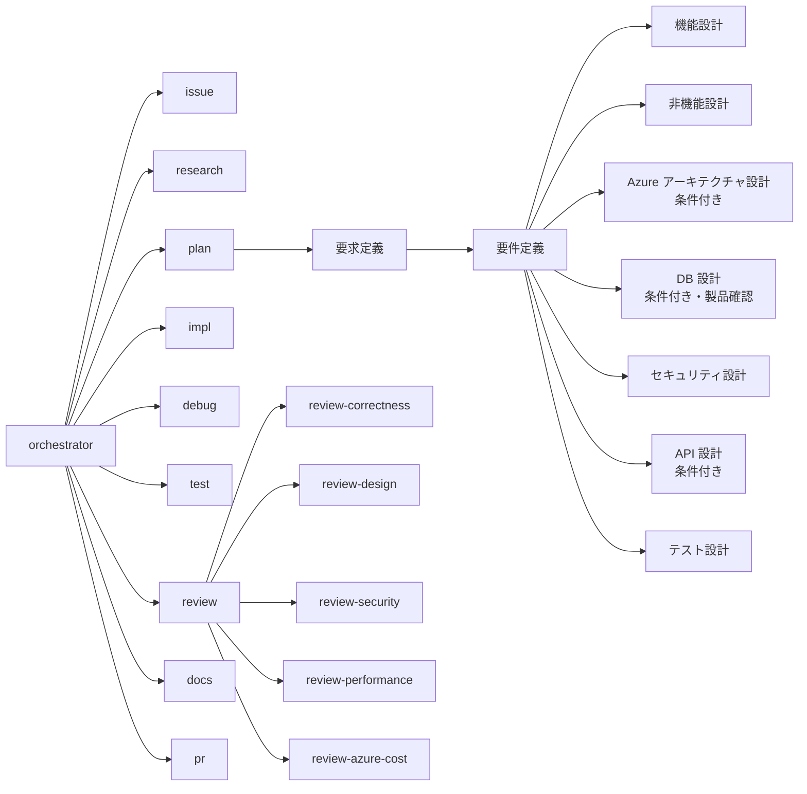

# ガイドライン

## 全般

- `.github/copilot-instructions.md` : Copilot の振る舞い

## サブエージェント

```
.github/
└── agents/
    ├── orchestrator.agent.md  # オーケストレーター
    ├── issue.agent.md         # Issue 作成/管理
    ├── research.agent.md      # 技術調査と選択肢の比較検討
    ├── plan.agent.md          # 計画オーケストレーター
    ├── plan-request-definition.agent.md       # 要求定義
    ├── plan-requirements-definition.agent.md  # 要件定義
    ├── plan-functional-design.agent.md        # 機能要件の設計
    ├── plan-nonfunctional-design.agent.md     # 非機能要件の設計
    ├── plan-azure-architecture.agent.md       # Azure アーキテクチャ設計
    ├── plan-database-design.agent.md          # DB 設計
    ├── plan-security-design.agent.md          # セキュリティ設計
    ├── plan-api-design.agent.md               # API 設計
    ├── plan-test-design.agent.md              # テスト設計
    ├── impl.agent.md          # TDD に基づく実装
    ├── debug.agent.md         # 不具合の根本原因分析と修正
    ├── test.agent.md          # テスト実行と失敗/カバレッジの分析
    ├── review.agent.md        # レビューの統括・統合
    ├── review-correctness.agent.md  # 要求適合・ロジック・テスト
    ├── review-design.agent.md       # 設計・可読性・ドキュメント
    ├── review-security.agent.md     # セキュリティ
    ├── review-performance.agent.md  # パフォーマンス
    ├── review-azure-cost.agent.md   # Azure コスト
    ├── docs.agent.md          # ドキュメントの作成/更新
    └── pr.agent.md            # PR 作成
```

### 呼び出し階層

`orchestrator` は `review` を呼び出し、`review` は `review-*` を呼び出します。また、`orchestrator` は `plan` を呼び出し、`plan` は要求定義・要件定義・各設計の `plan-*` エージェントを統括します。



Plan Agent とその `plan-*` エージェントは Plan mode 専用です。カスタムエージェントの frontmatter ではセッションモードを指定できないため、呼び出し元が Plan mode を選択し、委譲中も維持してください。各エージェント本文にも計画・読み取り専用の指示を記載しています。未対応の `mode: plan` frontmatter は追加しないでください。

ネストを成立させるための frontmatter 設定は以下のとおりです。

| エージェント | `tools` に `agent` | `user-invocable` | `disable-model-invocation` |
| --- | --- | --- | --- |
| `orchestrator` | 必要 | `true` | `true` |
| `plan`, `review` | 必要 | `true` | `false` |
| その他の作業エージェント（`plan-*` を含む） | 不要 | `true` | `false` |
| `review-*` | 不要 | `false` | `false` |

- 親になるエージェント (`orchestrator`, `plan`, `review`) は `tools` に `agent` を含め、`#tool:agent/runSubagent` で子を呼び出します。
- 子として呼ばれるエージェントは `disable-model-invocation: false` にします。`true` にすると親から呼び出せません。
- `review-*` は `user-invocable: false` としてユーザーのエージェント一覧に出さず、`review` 経由でのみ実行します。
- `review-*` は `tools` に `agent` を含めないため、これ以上ネストしません（葉ノード）。
